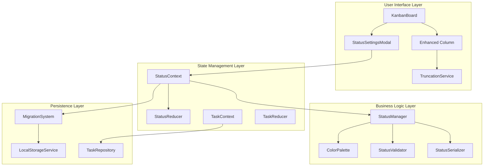
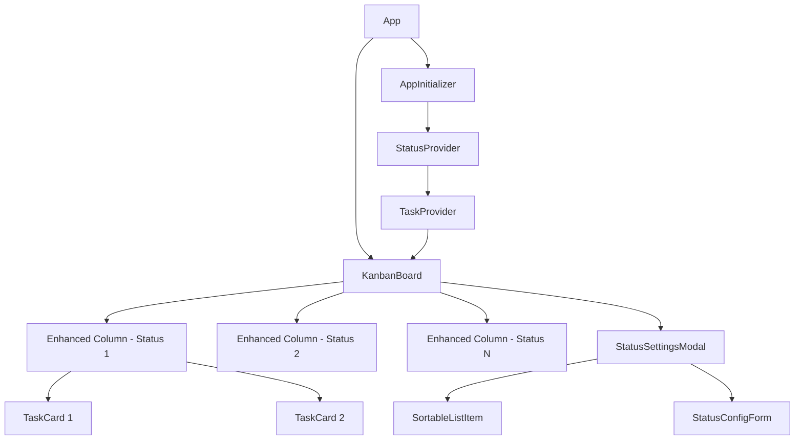

# カスタムタスク状態管理システム技術設計

## Overview

カスタムタスク状態管理システムは、既存のkanban-task-managerにユーザー定義の状態を追加し、動的な列管理を可能にする包括的な拡張機能です。システムは既存のReact/TypeScriptアーキテクチャと統合し、ローカルストレージでの永続化、LAB色空間による視覚的一貫性、そして@dnd-kit/sortableを用いたモダンなドラッグ&ドロップ機能を提供します。

設計は以下の核心原則に基づいています：
- **アクセシビリティファースト**: WCAG AA準拠（コントラスト比4.5:1以上）
- **レスポンシブ設計**: デスクトップ・モバイル両対応の状態名表示
- **データ整合性**: 厳格な検証とエラーハンドリング
- **パフォーマンス**: 効率的な状態管理と最適化されたレンダリング
- **拡張性**: 将来の機能追加を考慮した設計

## Architecture

### システム統合図



### コンポーネント階層



### データフロー

1. **初期化フロー**:
   - AppInitializer → MigrationSystem → StatusContext → TaskContext
   - レガシーデータ検出 → v2フォーマット変換 → 状態初期化

2. **状態管理フロー**:
   - StatusSettingsModal → StatusContext → StatusReducer → LocalStorageService
   - リアルタイムプレビュー → 検証 → 永続化

3. **ドラッグ&ドロップフロー**:
   - @dnd-kit/sortable → StatusReducer → ColorPalette → UI更新

## Components and Interfaces

### StatusManager Context

既存のTaskContextパターンに従い、状態管理の中央制御を提供します。

```typescript
interface StatusContextValue {
  // 状態管理
  statuses: CustomStatus[];
  loading: boolean;
  error: string | null;
  
  // CRUD操作
  createStatus: (name: string) => Promise<CustomStatus>;
  updateStatus: (id: string, updates: Partial<CustomStatus>) => Promise<void>;
  deleteStatus: (id: string) => Promise<void>;
  reorderStatuses: (fromIndex: number, toIndex: number) => Promise<void>;
  
  // クエリ操作
  getStatusById: (id: string) => CustomStatus | undefined;
  getStatusByPosition: (position: number) => CustomStatus | undefined;
  getColorForStatus: (id: string) => StatusColor;
  
  // 検証
  validateStatusName: (name: string, excludeId?: string) => ValidationResult;
  canDeleteStatus: (id: string) => { canDelete: boolean; reason?: string };
}
```

### StatusSettingsModal

@dnd-kit/sortableを用いたモダンなドラッグ&ドロップ対応の設定UI。

```typescript
interface StatusSettingsModalProps {
  isOpen: boolean;
  onClose: () => void;
}

interface SortableStatusItemProps {
  status: CustomStatus;
  index: number;
  color: StatusColor;
  onEdit: (id: string, name: string) => void;
  onDelete: (id: string) => void;
  onStartEdit: (id: string) => void;
  onCancelEdit: () => void;
}
```

**主要機能**:
- リアルタイム色プレビュー（順序変更時の即座更新）
- インライン編集（ダブルクリック → 編集モード）
- 削除保護（タスクが存在する状態の削除防止）
- アクセシブルなドラッグ&ドロップ（キーボード操作対応）

### Enhanced Column Component

既存のColumnコンポーネントを拡張し、動的状態対応とレスポンシブ表示を実装。

```typescript
interface EnhancedColumnProps {
  status: CustomStatus;
  onAddTask: (statusId: string) => void;
  onEditTask: (taskId: string) => void;
  onDeleteTask: (taskId: string) => void;
}

interface ColumnDisplayConfig {
  title: string;
  truncatedTitle: string;
  fullTitle: string;
  backgroundColor: string;
  accentColor: string;
  shouldTruncate: boolean;
}
```

**省略表示ロジック**:
```typescript
class TruncationService {
  private static readonly DESKTOP_MAX_LENGTH = 20;
  private static readonly MOBILE_MAX_LENGTH = 15;
  
  static getTruncatedDisplay(
    statusName: string, 
    screenSize: 'desktop' | 'mobile'
  ): TruncatedDisplayResult {
    const maxLength = screenSize === 'desktop' 
      ? this.DESKTOP_MAX_LENGTH 
      : this.MOBILE_MAX_LENGTH;
      
    if (statusName.length <= maxLength) {
      return {
        displayText: statusName,
        shouldShowTooltip: false,
        fullText: statusName
      };
    }
    
    return {
      displayText: statusName.substring(0, maxLength - 1) + '…',
      shouldShowTooltip: true,
      fullText: statusName
    };
  }
}
```

### ColorPalette System

LAB色空間を用いた位置ベースの色生成システム。WCAG AA準拠のコントラスト比を保証します。

```typescript
class ColorPalette {
  // LAB色空間での基準値
  private static readonly BASE_LIGHTNESS = 85;  // 背景色用
  private static readonly BASE_CHROMA = 30;     // 彩度
  private static readonly ACCENT_LIGHTNESS = 45; // アクセント色用
  
  static generateStatusColors(
    statusCount: number,
    position: number
  ): StatusColor {
    // 色相を均等分割（360度 / statusCount）
    const hueStep = 360 / Math.max(statusCount, 3);
    const hue = (position * hueStep) % 360;
    
    // LAB色空間での計算
    const backgroundColor = this.labToHex(
      this.BASE_LIGHTNESS,
      this.BASE_CHROMA * Math.cos(hue * Math.PI / 180),
      this.BASE_CHROMA * Math.sin(hue * Math.PI / 180)
    );
    
    const accentColor = this.labToHex(
      this.ACCENT_LIGHTNESS,
      this.BASE_CHROMA * 1.5 * Math.cos(hue * Math.PI / 180),
      this.BASE_CHROMA * 1.5 * Math.sin(hue * Math.PI / 180)
    );
    
    // WCAG AA準拠チェック
    const contrastRatio = this.calculateContrastRatio(backgroundColor, accentColor);
    if (contrastRatio < 4.5) {
      // コントラスト不足の場合は明度調整
      return this.adjustForContrast(backgroundColor, accentColor);
    }
    
    return { backgroundColor, accentColor, contrastRatio };
  }
  
  private static calculateContrastRatio(color1: string, color2: string): number {
    const luminance1 = this.getRelativeLuminance(color1);
    const luminance2 = this.getRelativeLuminance(color2);
    const lighter = Math.max(luminance1, luminance2);
    const darker = Math.min(luminance1, luminance2);
    
    return (lighter + 0.05) / (darker + 0.05);
  }
}
```

### MigrationSystem

v1からv2への自動データ移行システム。

```typescript
interface MigrationResult {
  success: boolean;
  migratedStatuses: CustomStatus[];
  updatedTasks: Task[];
  errors: MigrationError[];
  backupCreated: boolean;
}

class MigrationSystem {
  static async migrateToV2(): Promise<MigrationResult> {
    const legacyData = this.detectLegacyData();
    
    if (!legacyData) {
      return this.createDefaultStatuses();
    }
    
    // バックアップ作成
    const backupKey = `kanban-tasks-backup-${Date.now()}`;
    localStorage.setItem(backupKey, JSON.stringify(legacyData));
    
    // レガシー状態をカスタム状態に変換
    const migratedStatuses = this.convertLegacyStatuses(legacyData);
    
    // タスクの状態参照を更新
    const updatedTasks = this.updateTaskReferences(
      legacyData.tasks, 
      migratedStatuses
    );
    
    return {
      success: true,
      migratedStatuses,
      updatedTasks,
      errors: [],
      backupCreated: true
    };
  }
  
  private static convertLegacyStatuses(data: LegacyStoredData): CustomStatus[] {
    const legacyStatuses = ['TODO', 'DOING', 'DONE'];
    
    return legacyStatuses.map((name, index) => ({
      id: crypto.randomUUID(),
      name,
      displayOrder: index,
      createdAt: new Date()
    }));
  }
}
```

## Data Models

### 核心データ構造

```typescript
interface CustomStatus {
  id: string;                    // UUID形式の一意識別子
  name: string;                  // 状態名（1-50文字）
  displayOrder: number;          // 表示順序（0から始まる整数）
  createdAt: Date;              // 作成日時
}

interface StatusColor {
  backgroundColor: string;       // 背景色（HEX形式）
  accentColor: string;          // アクセント色（HEX形式）
  contrastRatio: number;        // コントラスト比（4.5以上）
}

interface ValidationResult {
  isValid: boolean;
  errors: ValidationError[];
}

interface ValidationError {
  field: string;
  message: string;
  code: string;
}
```

### 拡張されたStoredData

```typescript
interface StoredDataV2 extends StoredData {
  version: '2.0.0';
  customStatuses: CustomStatus[];
  migrationInfo?: {
    migratedFrom: string;
    migratedAt: string;
    backupKey: string;
  };
}

// タスク構造の拡張
interface TaskV2 extends Omit<Task, 'status'> {
  statusId: string;  // CustomStatus.idを参照
}
```

### 状態管理モデル

```typescript
interface StatusState {
  statuses: CustomStatus[];
  loading: boolean;
  error: string | null;
  colorCache: Map<string, StatusColor>;  // パフォーマンス最適化
  validationCache: Map<string, ValidationResult>;
}

type StatusAction =
  | { type: 'LOAD_STATUSES_START' }
  | { type: 'LOAD_STATUSES_SUCCESS'; payload: CustomStatus[] }
  | { type: 'LOAD_STATUSES_ERROR'; payload: string }
  | { type: 'CREATE_STATUS'; payload: CustomStatus }
  | { type: 'UPDATE_STATUS'; payload: { id: string; updates: Partial<CustomStatus> } }
  | { type: 'DELETE_STATUS'; payload: string }
  | { type: 'REORDER_STATUSES'; payload: { fromIndex: number; toIndex: number } }
  | { type: 'CLEAR_ERROR' }
  | { type: 'INVALIDATE_CACHE'; payload?: string };
```

## Correctness Properties

*プロパティとは、システムの全ての有効な実行において真であるべき特性や動作のことです。プロパティは、人間が読める仕様と機械で検証可能な正確性保証の橋渡しをする形式的な記述として機能します。*

### Property 1: ステータス設定のシリアライゼーション往復

*すべての* 有効なカスタムステータス設定について、シリアライゼーションしてからデシリアライゼーションすると、元と等価なオブジェクトが生成される

**Validates: Requirements 10.3**

### Property 2: ステータス名検証の一貫性

*すべての* ステータス名入力について、Status_Validatorによる解析と検証の結果は、同じ入力に対して常に同じ結果を返す

**Validates: Requirements 9.1, 9.2, 9.4**

### Property 3: 色生成の位置一貫性

*すべての* ステータスリストと位置の組み合わせについて、Color_Paletteは位置が同じであれば表示順序に関係なく同じ色を生成する

**Validates: Requirements 4.3, 4.4**

### Property 4: 表示順序の整合性維持

*すべての* 並び替え操作について、操作後のステータスリストのdisplayOrderは0から始まる連続した整数で重複がない

**Validates: Requirements 3.2, 3.3**

### Property 5: WCAG準拠コントラスト保証

*すべての* 生成された色の組み合わせについて、背景色とアクセント色のコントラスト比は4.5:1以上である

**Validates: Requirements 4.2**

### Property 6: ステータス削除保護

*すべての* ステータス削除要求について、そのステータスを使用するタスクが存在する場合は削除が防止される

**Validates: Requirements 2.1, 2.2**

### Property 7: 省略表示の一貫性

*すべての* ステータス名と画面サイズの組み合わせについて、TruncationServiceは最大文字数を超える場合に必ず省略記号を付加し、ツールチップ表示フラグをtrueに設定する

**Validates: Requirements 5.1, 5.2, 5.3**

### Property 8: マイグレーション可逆性

*すべての* v1データについて、v2にマイグレーションした後に元のタスク内容とステータスの対応関係が保持される

**Validates: Requirements 7.2, 7.3**

### Property 9: ステータス管理不変条件

*すべての* ステータス管理操作について、システムは常に最低1つのステータスを維持し、最後のステータスの削除は防止される

**Validates: Requirements 1.4, 1.5**

### Property 10: ユニークIDとシーケンシャル順序生成

*すべての* 新規ステータス作成について、生成されるIDは一意であり、displayOrderは既存の最大値+1が割り当てられる

**Validates: Requirements 1.2**

### Property 11: 依存関係チェックの正確性

*すべての* ステータスとタスクの組み合わせについて、Status_Managerの依存関係チェックは、実際のタスク-ステータス関連を正確に反映する

**Validates: Requirements 2.1, 2.3**

### Property 12: リアルタイムプレビュー同期

*すべての* ステータス順序変更について、Status_Settings_Modalのカラープレビューは即座に新しい位置に基づく色を表示する

**Validates: Requirements 8.3**

## Error Handling

### エラー分類と処理戦略

```typescript
enum ErrorSeverity {
  WARNING = 'warning',    // 警告（機能継続可能）
  ERROR = 'error',       // エラー（機能停止）
  CRITICAL = 'critical'  // 致命的（データ破損の可能性）
}

interface SystemError {
  code: string;
  message: string;
  severity: ErrorSeverity;
  context: Record<string, unknown>;
  timestamp: Date;
  recoveryAction?: () => Promise<void>;
}
```

### エラー処理方針

**データ整合性エラー**:
- 状態の重複ID検出 → 自動UUID再生成
- 表示順序の不整合 → 自動再番号付け
- タスクの無効な状態参照 → デフォルト状態に移動

**バリデーションエラー**:
- 状態名の重複 → ユーザーに再入力要求
- 文字数超過 → リアルタイム警告表示
- 空の状態名 → フォーム送信ブロック

**ストレージエラー**:
- 容量不足 → データ圧縮・古いバックアップ削除
- アクセス拒否 → セッションストレージへのフォールバック
- データ破損 → バックアップからの復旧

## Testing Strategy

このシステムでは、包括的なテスト戦略として**プロパティベーステスト**と**ユニットテスト**の二重アプローチを採用します。

### プロパティベーステスト

**fast-check**ライブラリを使用して、システムの正確性プロパティを検証します。

各プロパティテストの設定:
- **実行回数**: 最低100回の反復
- **タグ形式**: `Feature: custom-task-status-manager, Property {番号}: {プロパティ文}`
- **ランダム入力**: 有効・無効な状態名、色値、順序組み合わせを自動生成

```typescript
// プロパティテスト例
describe('Property 1: Serialization Round Trip', () => {
  it('Feature: custom-task-status-manager, Property 1: 状態設定のシリアライゼーション往復', () => {
    fc.assert(fc.property(
      fc.array(customStatusArbitrary, { minLength: 1, maxLength: 10 }),
      (statuses) => {
        const serialized = StatusSerializer.serialize(statuses);
        const deserialized = StatusSerializer.deserialize(serialized);
        expect(deserialized).toEqual(statuses);
      }
    ), { numRuns: 100 });
  });
});
```

### ユニットテスト

具体的な例、エッジケース、エラー条件をテストします。

**テスト対象**:
- コンポーネントの統合ポイント（StatusContext ↔ TaskContext）
- エラーハンドリング（ネットワーク障害、データ破損）
- UI相互作用（ドラッグ&ドロップ、モーダル操作）
- アクセシビリティ（キーボード操作、スクリーンリーダー対応）

```typescript
// ユニットテスト例
describe('StatusManager Error Handling', () => {
  test('should prevent deletion of status with existing tasks', async () => {
    const mockContext = createMockStatusContext();
    const statusId = 'status-with-tasks';
    
    const result = await mockContext.canDeleteStatus(statusId);
    
    expect(result.canDelete).toBe(false);
    expect(result.reason).toContain('タスクが存在します');
  });
});
```

### テストカバレッジ目標

- **プロパティテスト**: 全ての正確性プロパティをカバー
- **ユニットテスト**: 85%以上のライン・ブランチカバレッジ
- **統合テスト**: 全ての主要なユーザーフロー
- **アクセシビリティテスト**: WCAG AA準拠の自動・手動チェック